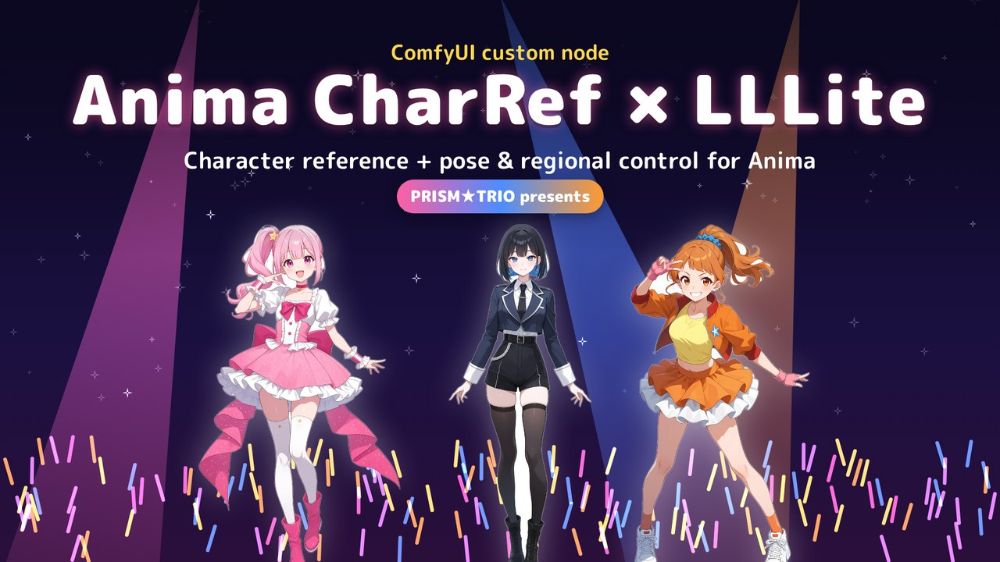
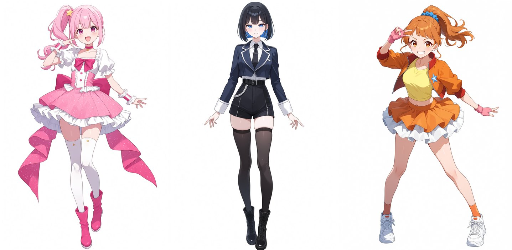
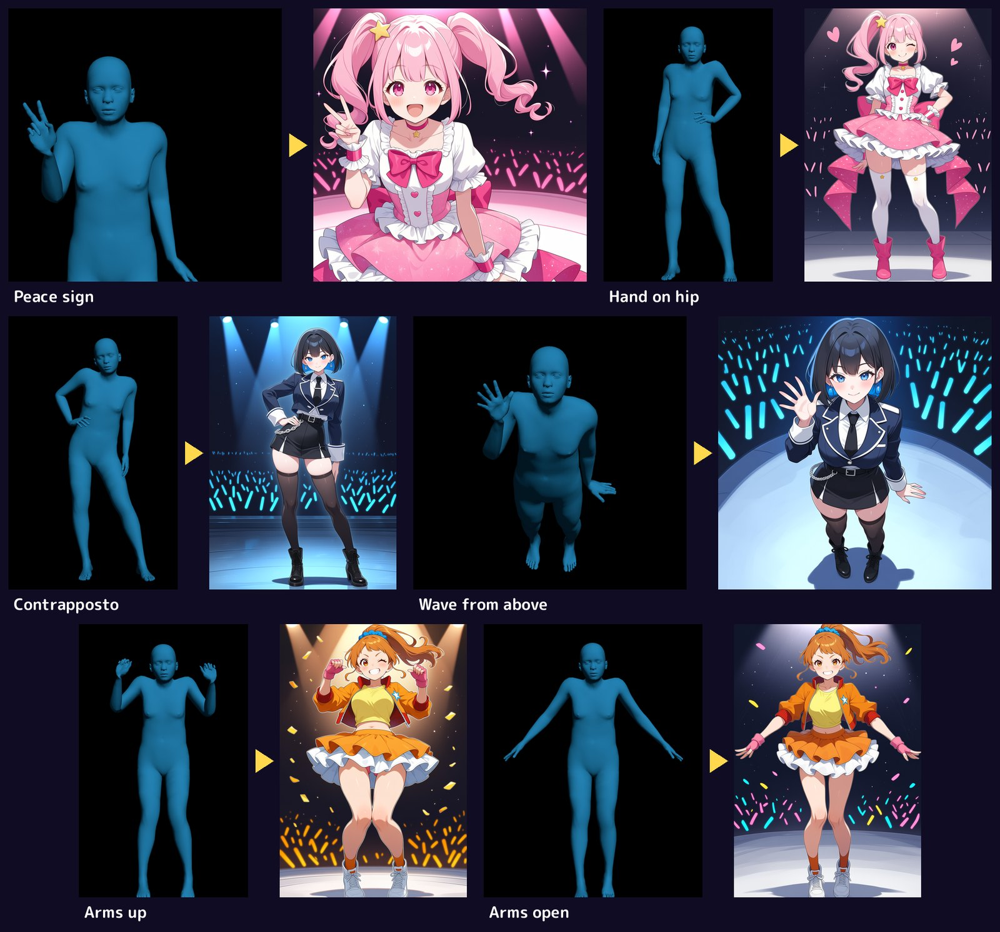
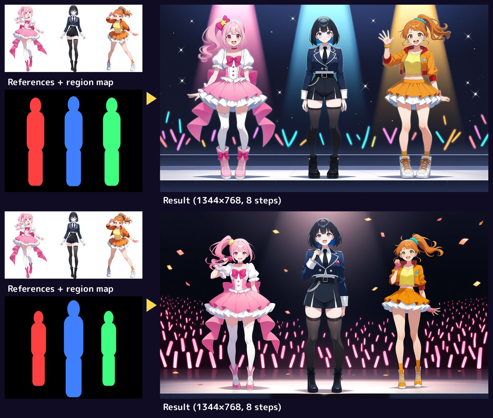

# ComfyUI-Anima-CharRef-LLLite

Use the [Anima Reference Adapter](https://github.com/ElectronGirl/ComfyUI-Anima-Ref-Adapter) (character
reference) together with [Anima ControlNet-LLLite](https://huggingface.co/toyxyz/Anima_ControlNet-LLLite)
control models (3D pose, regional layout) in the same generation.

[](https://github.com/quinteroac/ComfyUI-Anima-CharRef-LLLite/releases/tag/v0.1.0)

*Intro video (73 s): click the image to watch it on the release page. Every image in it was made with these nodes
and Anima Turbo.*

## Examples

All made with Anima Turbo (8 steps, CFG 1), the Ref Adapter v2 and the workflows in [`workflows/`](workflows).

**Character references** — one image per character, no LoRA training:



**3D pose** — a shaded mannequin render on black (`anima_3dpose_6200`) plus one reference:



**Regional** — the three references stitched side by side plus a painted region map (`anima_regional_4335`, active
0 → 0.3) and a prompt that says who is on the left, in the middle and on the right:



The Ref Adapter adds the reference as an extra frame next to the image being generated. ComfyUI's stock
LLLite patch expects only the generated image's tokens, so the two do not combine out of the box. These nodes
run the Ref Adapter forward with the model patches applied and keep the LLLite control on the generated
frame only; the reference frame never receives it.

Both Ref Adapter versions work in the same loader: v2 (`"arch": "asym"`, asymmetric attention with a cached
reference) and the pilot v1 (joint reference frame).

## Nodes

All in *Anima Ref Adapter/experimental*.

| Node | What it does |
|---|---|
| **Anima Ref Adapter + Controls (Experimental)** | Same inputs as *Anima Ref Adapter Loader*; replaces its forward so model patches (LLLite) run with the reference. Use it instead of the stock loader. |
| **Anima LLLite + Character Ref (Experimental)** | Applies an LLLite `MODEL_PATCH` (from the core *ModelPatchLoader*) to the generated frame only. `strength`, `start_percent`, `end_percent` as in the core LLLite node. |
| **Anima 3D Mesh → Regional Map** | Turns a colored mesh render into flat region colors (palette `#ff4040,#4080ff,#40ff80,#ffdf40`) for the regional LLLite. |

Chain: `UNETLoader → Anima LLLite + Character Ref → Anima Ref Adapter + Controls → …`, then *Anima Ref Latent*
and *Anima Ref Guider* from the Ref Adapter as usual.

## Install

Requires [ComfyUI-Anima-Ref-Adapter](https://github.com/ElectronGirl/ComfyUI-Anima-Ref-Adapter) and a ComfyUI
version with Anima LLLite support (core *ModelPatchLoader*).

```bash
cd ComfyUI/custom_nodes
git clone https://github.com/ElectronGirl/ComfyUI-Anima-Ref-Adapter
git clone https://github.com/quinteroac/ComfyUI-Anima-CharRef-LLLite
```

Restart ComfyUI.

## Workflows

In [`workflows/`](workflows). Each one has a note with every model and custom node it needs, with download links.

| Workflow | |
|---|---|
| `anima_charref_pose_simple.json` | **Start here.** Character reference + 3D pose from a mesh image, core nodes only (no Pixaroma, rgthree or Pose Studio). Load any shaded 3D body render on black, e.g. toyxyz's [sample pose](https://huggingface.co/toyxyz/Anima_ControlNet-LLLite/blob/main/example_workflow/3dpose_example.png) (save it as `input/anima_pose/3dpose_example.png`); the output size follows the pose image. |
| `anima_charref_posestudio_turbo.json` | Character reference + 3D pose from Pose Studio. Optional pose import (SAM3D) from another image or from the character reference itself, and output size taken from the Pose Studio render. |
| `anima_charref_posestudio_moss_upscale.json` | The same, plus an optional 2nd pass / hi-res fix with MOSS-Image up to 5 MP. |
| `anima_charref_regional_paint_turbo.json` | 1 to 3 character references stitched side by side + a regional map painted in Pixaroma Paint. |

All of them use Anima Turbo (8 steps, CFG 1), Anima Safe PAG and Anima Style Explorer for the prompt; all but
the simple one add Pixaroma groups with on/off switches. The example images and the regional paint layers are not included: load your
own references and paint the regions in the Paint editor.

Custom nodes used by the workflows:
[ComfyUI-Anima-Ref-Adapter](https://github.com/ElectronGirl/ComfyUI-Anima-Ref-Adapter),
[comfyui-anima-safe-pag](https://github.com/iljung1106/comfyui-anima-safe-pag),
[comfyui-anima-style-nodes](https://github.com/fulletLab/comfyui-anima-style-nodes),
[ComfyUI-Pixaroma](https://github.com/pixaroma/ComfyUI-Pixaroma) and [rgthree-comfy](https://github.com/rgthree/rgthree-comfy) (all but the simple workflow),
[ComfyUI_VNCCS_Utils](https://github.com/AHEKOT/ComfyUI_VNCCS_Utils) (Pose Studio workflows).

## Notes

- The LLLite control models were trained on Anima Base; with Anima Turbo they are experimental.
- Multiple characters follow the Ref Adapter v2 recipe: references side by side, and a prompt that says who is
  on the left / middle / right. Two characters are officially supported; three work but can mix features.

## Acknowledgements

- The workflow layout is based on the Krea 2 Pose Studio workflow by
  [foxfuressence](https://www.youtube.com/@foxfuressence).
- [ElectronGirl/ComfyUI-Anima-Ref-Adapter](https://github.com/ElectronGirl/ComfyUI-Anima-Ref-Adapter) — the
  reference adapter; the reference-frame forward here follows its implementation (Apache-2.0).
- [toyxyz/Anima_ControlNet-LLLite](https://huggingface.co/toyxyz/Anima_ControlNet-LLLite) — 3D pose and regional
  LLLite models.
- [circlestone-labs/Anima](https://huggingface.co/circlestone-labs/Anima) — the Anima models.
- [AHEKOT/ComfyUI_VNCCS_Utils](https://github.com/AHEKOT/ComfyUI_VNCCS_Utils) — Pose Studio.
- [pixaroma/ComfyUI-Pixaroma](https://github.com/pixaroma/ComfyUI-Pixaroma) — workflow UI nodes and Paint.
- [iljung1106/comfyui-anima-safe-pag](https://github.com/iljung1106/comfyui-anima-safe-pag),
  [fulletLab/comfyui-anima-style-nodes](https://github.com/fulletLab/comfyui-anima-style-nodes),
  [rgthree/rgthree-comfy](https://github.com/rgthree/rgthree-comfy).
- [Comfy-Org/MOSS-Image](https://huggingface.co/Comfy-Org/MOSS-Image) and
  [lodestones/MOSS-Image-Base-8-steps-dmd](https://huggingface.co/lodestones/MOSS-Image-Base-8-steps-dmd) — 2nd pass.

## License

Apache-2.0
